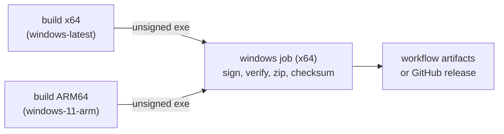

<!--
Copyright 2026 Michael F. Collins, III
Licensed under the Naked Time license. See LICENSE.md for details.
-->

# Sign Windows builds with Azure Artifact Signing

## Context and Problem Statement

The Windows builds (`x86_64-pc-windows-msvc` and `aarch64-pc-windows-msvc`)
ship unsigned executables. Windows SmartScreen and antivirus software warn
about, or block, unsigned downloads from an unknown publisher. How do we sign
both executables automatically with Azure Artifact Signing?

This extends [Build and publish release binaries on native runners for five
targets](draft-release-build-targets.md), which defines the build workflow and
the Windows targets.

## Decision Drivers

* Both Windows architectures must be signed and timestamped.
* Signing must be automated in the existing `build.yml`.
* No long-lived Azure credential should be stored in GitHub.
* Signing must not be exposed to pull requests.
* ARM64 should keep building on a native runner.
* `azure/artifact-signing-action` does not support Windows ARM runners.

## Considered Options

* Build natively, then sign both executables in a separate x64 job
* Cross-compile ARM64 on an x64 runner and sign in the build job
* Run SignTool and the Artifact Signing library manually on the ARM runner

## Decision Outcome

Chosen option: "Build natively, then sign both executables in a separate x64
job", because it keeps native ARM64 builds, uses only the supported signing
action, and limits Azure access to one job.

* **Build.** The Windows matrix jobs upload only the unsigned executable, kept
  for one day.
* **Signing.** The `windows` job signs both executables with SHA-256 and an
  RFC 3161 timestamp from `http://timestamp.acs.microsoft.com`, so signatures
  stay valid after the short-lived signing certificate expires. It then packages
  and checksums the signed files.
* **Authentication.** `azure/login` uses OpenID Connect federation. No client
  secret is stored.
* **When it runs.** `build.yml` takes a `sign_windows` input. `ci.yml` sets it
  for pushes to `main` only (not pull requests or manual runs), and
  `release-please.yml` always sets it. Both callers grant `id-token: write`.

### One-time Azure setup

1. Create an Artifact Signing account, complete identity validation, and create
   a *Public Trust* certificate profile. Note the account's regional endpoint,
   for example `https://eus.codesigning.azure.net`.
2. Create a Microsoft Entra app registration with a service principal, and add a
   federated credential:
   * Issuer: `https://token.actions.githubusercontent.com`
   * Audience: `api://AzureADTokenExchange`
   * Subject: `repo:mfcollins3@104274/time@1467128002:ref:refs/heads/main`
     (this repository uses GitHub's immutable subject format)
3. Assign the **Artifact Signing Certificate Profile Signer** role to the
   service principal, scoped to the certificate profile.
4. Store the configuration in GitHub:

| Name                                   | Kind     | Contents                            |
|----------------------------------------|----------|-------------------------------------|
| `AZURE_CLIENT_ID`                      | secret   | Application (client) ID             |
| `AZURE_TENANT_ID`                      | secret   | Directory (tenant) ID               |
| `AZURE_SUBSCRIPTION_ID`                | secret   | Subscription of the signing account |
| `ARTIFACT_SIGNING_ENDPOINT`            | variable | Regional endpoint URL               |
| `ARTIFACT_SIGNING_ACCOUNT`             | variable | Artifact Signing account name       |
| `ARTIFACT_SIGNING_CERTIFICATE_PROFILE` | variable | Certificate profile name            |

### Consequences

* Good, because no certificate or private key is stored or renewed by us.
* Good, because only one job can obtain Azure credentials from this workflow.
* Bad, because signed builds depend on Azure being available.
* Bad, because the extra job adds time, and a failure in either Windows build
  stops both Windows packages.
* Bad, because the federated credential only trusts `main`, so signing cannot be
  tried from another branch.
* Bad, because SmartScreen may still warn until the publisher builds reputation.

### Confirmation

On a push to `main`, the `windows` job must report a `Valid`, timestamped
signature for both executables. On Windows, an executable extracted from a
downloaded `.zip` must show the expected publisher under Properties > Digital
Signatures.

## Pros and Cons of the Options

### Build natively, then sign both executables in a separate x64 job

* Good, because it uses the supported action and keeps native builds.
* Bad, because unsigned executables pass between jobs as artifacts.

### Cross-compile ARM64 on an x64 runner and sign in the build job

* Good, because the workflow is simpler.
* Bad, because it reverses the native-runner decision for Windows ARM64.

### Run SignTool and the Artifact Signing library manually on the ARM runner

* Good, because each build job stays self-contained.
* Bad, because it is unsupported on ARM and needs custom tool installation.

## More Information

* [Artifact Signing GitHub Action](https://github.com/Azure/artifact-signing-action)
* [Set up signing integrations to use Artifact Signing](https://learn.microsoft.com/azure/artifact-signing/how-to-signing-integrations)
